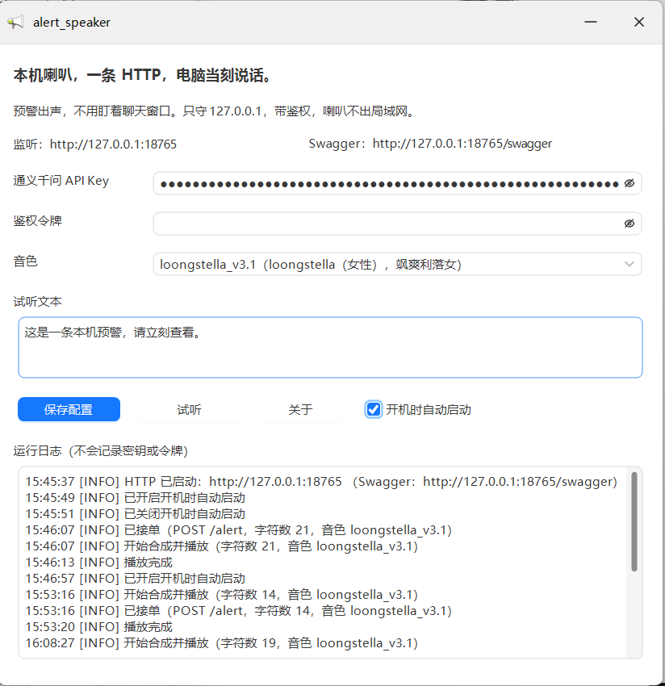

# alert_speaker

本机喇叭，一条 HTTP，电脑当刻说话。

alert_speaker 是一个运行在 Windows 上的托盘小工具：本机进程常驻后，你的脚本或 Agent 只要向本机 HTTP 接口发送一句文本，电脑就会用通义千问 TTS 立刻播报出来。它只监听 `127.0.0.1`，可选鉴权，喇叭不会出到局域网。

<p align="center">
  
</p>

## 环境要求

- Windows
- .NET 8
- 通义千问 API Key（用于 TTS）

## 编译与运行

在仓库根目录执行：

```bat
dotnet build src\AlertSpeaker.csproj -c Release
dotnet run --project src\AlertSpeaker.csproj -c Release
```

也可以直接运行 Release 输出目录中的可执行文件：

```bat
src\bin\Release\net8.0-windows\alert_speaker.exe
```

也可以打开 `src\alert_speaker.sln` 进行编译。

## 托盘常驻与单实例

- 关闭主窗口只会隐藏到托盘，进程不会退出。
- 双击托盘图标可重新打开主窗口；托盘菜单提供「打开主窗口」「关于」「退出」。
- 选择托盘菜单「退出」才会结束进程。
- 通过互斥体保证单实例。再次启动会提示「alert_speaker 已在运行。请从托盘打开主窗口。」
- HTTP 服务只绑定 `127.0.0.1:18765`。若该地址已被占用，服务启动会失败并弹出说明，不会再开一个监听。

首次运行若还没有 `App.json`，程序会在可执行文件所在目录自动生成一份（`AlertToken` 默认为空、默认音色，API Key 待填写；若环境变量 `QWEN_API_KEY` 已设置，生成时会写入该值）。请填入通义千问 API Key 后保存。

## HTTP 接口

- 监听地址（固定，不可改）：`http://127.0.0.1:18765`
- 只绑定本机回环地址，不监听 `0.0.0.0`，不要把该端口暴露到局域网或公网
- Swagger 文档：http://127.0.0.1:18765/swagger
- 路径：`/alert`
- 方法：`GET` 与 `POST`

调用约定：

- `GET /alert?text=...`（适合短文本）
- `POST` 建议使用 JSON body `{"text":"..."}`，也可以使用同名 query `text`
- `text` 缺省或全是空白时返回 `400`，并且不播报
- 可选请求头 `X-Alert-Token`。若 `App.json` 中的 `AlertToken` 为空或全空白，则不要求鉴权，无头或空头也可以调用 `/alert`。若已填写令牌，则必须携带该请求头；错或缺令牌返回 `401`，并且不播报
- 未配置 `QwenApiKey` 时返回 `503`，并且不播报
- 成功接单后立即返回 `202 Accepted`，再异步进行 TTS 和播放，避免 HTTP 卡在播音上。多条警告按队列顺序播放，不会叠音

已设置令牌时的示例：

```bat
curl -s -D - -o - -H "X-Alert-Token: YOUR_ALERT_TOKEN" "http://127.0.0.1:18765/alert?text=仓库构建失败，请立刻查看"
```

```bat
curl -s -D - -o - -H "X-Alert-Token: YOUR_ALERT_TOKEN" -H "Content-Type: application/json" -d "{\"text\":\"仓库构建失败，请立刻查看\"}" http://127.0.0.1:18765/alert
```

未设置令牌时，去掉 `-H "X-Alert-Token: YOUR_ALERT_TOKEN"` 即可。

成功时响应类似：

```json
{"accepted":true,"status":"queued"}
```

## 配置

配置文件是可执行文件所在目录（`AppContext.BaseDirectory`）下的 `App.json`，不是当前工作目录。请不要把真实的 `App.json` 提交到版本库（已被 `.gitignore` 忽略）。字段名以仓库中的 `App.json.example` 为准，例如：

```json
{
  "QwenApiKey": "YOUR_QWEN_API_KEY",
  "AlertToken": "",
  "Voice": "longanhuan_v3.1",
  "StartWithWindows": false
}
```

| 字段 | 含义 |
| --- | --- |
| `QwenApiKey` | 通义千问 API Key。未配置时，主窗口试听会提示，`/alert` 返回 503，进程不会退出。 |
| `AlertToken` | 调用 `/alert` 的鉴权令牌。为空或全空白时不要求鉴权。已填写时，必须在请求头 `X-Alert-Token` 中携带该令牌。 |
| `Voice` | 当前音色 Id。默认 `longanhuan_v3.1`（龙安欢）。必须是内置系统音色表中的 Id。 |
| `StartWithWindows` | 是否在当前用户登录 Windows 时自动启动。默认 `false`。缺失按 `false`。 |

主窗口可填写 API Key 与令牌、切换音色，并输入文本后点击「试听」。API Key 与鉴权令牌输入框默认显示为密文，点击右侧眼睛图标可切换明文或密文。「关于」窗口会说明当前鉴权方式；若已设置令牌，关于页还会显示当前令牌值，便于粘贴到 Swagger。

在主窗口「音色」下拉框中选择一项后，程序会立即把所选 Id 写入 `App.json` 的 `Voice` 字段。切换后，试听和 HTTP `/alert` 都会按当前音色播报。

## 可选的开机启动

主窗口提供「开机时自动启动」复选框，默认关闭。勾选后立即把 `StartWithWindows` 写入 `App.json`，并在当前用户的注册表

`HKCU\Software\Microsoft\Windows\CurrentVersion\Run`

下登记值名 `alert_speaker`，值为带引号的可执行文件绝对路径。取消勾选则立即写入 `false` 并删除该项。不必先点「保存配置」。该登记只针对当前用户，不需要管理员权限，也不会写入 `HKLM`。

## 安全说明

- 服务只绑定 `127.0.0.1`，不要端口转发、不要内网穿透、不要改成 `0.0.0.0`
- 不要把真实的 `App.json`、API Key 或鉴权令牌提交到 Git
- 运行日志不会记录密钥或令牌

## 相关项目

如果你还需要在 Windows 上做微信自动化，也可以看看开源的 WeChatAuto.SDK 社区版：

- 仓库：https://github.com/scottfly189/WeChatAuto.SDK
- 文档：https://scottfly189.github.io/WeChatAuto.SDK/

## 许可证

本项目采用 [MIT License](LICENSE)。

---

## English

alert_speaker is a Windows tray app that speaks short local alerts with Qwen TTS. Scripts or agents can call `http://127.0.0.1:18765/alert` (GET or POST). The server binds only to localhost, never `0.0.0.0`. Closing the main window hides it to the tray; use the tray menu **退出** to quit. A second launch reports that it is already running. Copy `App.json.example` to `App.json` in the executable directory (`AppContext.BaseDirectory`), set your Qwen API key, and do not commit `App.json`. Optional current-user autostart is available from the main UI checkbox. Licensed under MIT. If you also need Windows WeChat automation, see the open-source WeChatAuto.SDK community edition: https://github.com/scottfly189/WeChatAuto.SDK.
